# 🐾 Mascote `<R/>` — pet de tela

O mascote da logo **&lt;rafinhadr/&gt;** morando no seu computador, no estilo do *Desktop Goose*.

## ⬇️ Como usar

1. Baixe o **`MascoteR.exe`** em **[Releases](https://github.com/Rafinhadrp/mascote-/releases/latest)**.
2. Dê dois cliques. Não precisa instalar nada.
   - Se aparecer "O Windows protegeu o computador": **Mais informações → Executar assim mesmo**
     (é porque o app não tem assinatura digital paga).
3. Pronto, ele está solto na sua tela. **Clique no iconezinho dele perto do relógio** pra:
   mandar ele roubar o mouse, se esconder, deixar bilhete, contar curiosidade, tocar violão ou dançar,
   **mudar o tamanho** (mini, pequeno, médio, grande),
   pausar as travessuras, **iniciar junto com o Windows** ou sair.

O `.exe` é gerado sozinho pelo GitHub (aba **Actions**) a cada mudança neste repositório.

**Botão de download no seu site** — este link sempre baixa a versão mais nova:

```html
<a href="https://github.com/Rafinhadrp/mascote-/releases/latest/download/MascoteR.exe">Baixar o Mascote &lt;R/&gt;</a>
```

## O que ele apronta

**Roubando o mouse** (cada vez de um jeito):
- Fica **desconfiado** olhando pro mouse e vai chegando **de fininho**, na ponta dos pés, sem dar um pio. Se você
  mexe o mouse, ele congela e disfarça. Quando chega pertinho, dá o bote.
- **Jeito escandaloso:** gargalha *"HEHEHE roubei seu mouse!"*, foge em zigue-zague arrastando o mouse, se esconde
  com ele atrás de um botão ou janela e devolve rindo, de óculos escuros 😎.
- **Jeito silencioso:** pega sem alarde e leva o mouse de fininho até um canto da tela. Se você perceber e mexer
  o mouse no caminho, ele leva um susto (*"eita! corre!"*) e sai correndo.
- Conta quantos já roubou no dia (*"já é o 3º mouse que eu roubo hoje 😎"*).
- **Pra se soltar:** sacode o mouse com força. Ele fica emburrado ou abre o berreiro 😭.

**Outras coisas que ele faz sozinho:**
- 📬 Tira um **bilhete** do bolso onde estiver e leva até o **canto de baixo da tela, igual notificação do
  Windows**. Ficam empilhados (no máximo 3), somem sozinhos depois de um tempo ou no ×.
- 📣 Vai pra um canto da tela, **pula e chama**: *"ei, ei! Você sabia que o Rafinha é o mais lindo do Brasil?"*
- 🎸 **Senta na barra de tarefas** com as perninhas penduradas e **toca violão**: anuncia a música
  (*"🎸 tocando: Malbec — Henrique & Diego e Dennis DJ"*) e canta com calma: às vezes um trecho, às vezes metade,
  de vez em quando a música inteira ou um medley de duas. Depois agradece e vai fazer outra coisa.
- Se esconde atrás de botões e janelas, espiando. Chegou perto? Leva um susto e foge.
- Dança, programa no notebook, fica pensando, boceja e dorme quando você some.
- Avisa a hora cheia (*"15h! bebe uma água 💧"*), lembra do almoço ao meio-dia e comemora a **sexta-feira** 🎉.
- Fala bastante e **não repete** uma frase até ter usado todas daquele tipo.

**🥚 Easter eggs:**
- **Rode o mouse em volta dele** duas vezes: ele fica tonto 😵.
- **Deixe o mouse paradinho em cima dele**: ele acha que é carinho 🥰.
- **Arraste e sacuda** ele: *"PARA DE ME SACUDIR!"*
- Clique 3 vezes rápido: cócegas 🤣. Clique **8 vezes**: ele fica bravo e vai se esconder.
- De vez em quando, do nada, ele faz um **moonwalk** 🕺.

| Cara | | Cara | |
|---|---|---|---|
|  | tramando | 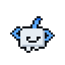 | de fininho |
| 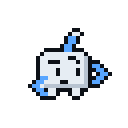 | desconfiado |  | rindo |
|  | fugindo com o mouse | 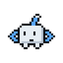 | espiando |
| 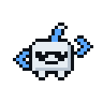 | estiloso |  | convencido |
|  | emburrado | 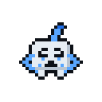 | chorando |
| 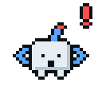 | assustado | 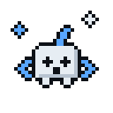 | tonto |
| 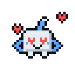 | apaixonado | 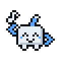 | dançando |
| 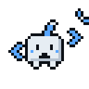 | chamando | 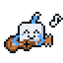 | tocando violão |
| 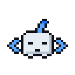 | bocejando | 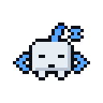 | dormindo |

> **Funciona melhor no Windows.** No macOS ele roda, mas não rouba o mouse nem acha os botões dos outros
> apps. No Linux rouba o mouse se tiver o `xdotool`.

## 🎤 Letras pro violão

Quando toca violão, ele anuncia a música e cantarola. Se você colocar a letra, ele **canta em legendinha**, uma
linha por vez, em cima dele:

1. Clique no ícone dele perto do relógio → **Abrir pasta das letras**
   (fica em `%APPDATA%\mascote-pet\letras`).
2. Crie um `.txt` com o nome da música (ex.: `Malbec.txt`) e cole a letra dentro. Cada linha vira uma legenda;
   linha em branco vira uma pausa com 🎶.
3. Pronto. Não precisa reiniciar. Música que só existe na pasta também entra no repertório.

As letras dessa pasta ficam só no seu computador.

**Quer que vá junto no `.exe`?** Coloque os `.txt` na pasta **`letras/`** deste repositório (no GitHub: entre na
pasta → **Add file → Create new file**, nome `Malbec.txt`, cole a letra e salve). O `.exe` novo sai sozinho em
Releases. Lembre que este repositório é público: o que estiver em `letras/` fica visível pra todo mundo.

## ⚙️ Configurando

O que dá pra mudar pelo menu do ícone fica salvo sozinho. O resto está no **`config.json`** (precisa gerar o
`.exe` de novo depois de mudar):

| Opção | O que faz |
|---|---|
| `tamanho` | tamanho em px (padrão 56; pelo menu: 48, 56, 72 ou 96) |
| `travessuras` | liga/desliga `roubarMouse`, `esconder`, `bilhetes`, `curiosidades`, `violao` |
| `botoesDeOutrosApps` | `false` = não procura botões dos outros programas (só janelas e bordas) |
| `intervaloRoubo` | segundos entre um roubo e outro, ex.: `[120, 300]` |
| `descanso` | segundos de sossego depois de cada travessura grande, ex.: `[45, 110]` |
| `sonoDepoisDe` | segundos sem mexer o mouse até ele dormir |
| `mensagens` | textos dos bilhetes |
| `bilheteSomeDepois` | segundos até o bilhete sumir sozinho (`0` = só fecha no ×) |
| `musicas` | o que ele toca no violão: `{ "musica": "...", "artista": "..." }` |
| `curiosidades` | o que ele grita no canto da tela (*"você sabia que..."*) |

Se algo der errado, tem um log em `%APPDATA%\mascote-pet\mascote-log.txt`.

## 🛠️ Rodando pelo código

Com o [Node.js LTS](https://nodejs.org) instalado: dois cliques no **`iniciar.bat`** (ou `npm install` e
`npm start`). Pra gerar o `.exe` na sua máquina: `npm run empacotar` (sai em `dist/MascoteR.exe`).

## 🌐 Também funciona em sites

O mesmo `mascote-pet.js` roda em qualquer página: copie ele e a pasta `sprites/` pro site e coloque antes do `</body>`:

```html
<script src="/mascote/mascote-pet.js" defer></script>
```

No site ele se esconde atrás dos botões e cards da página e esconde o mouse pra você ir buscar. O
`demo.html` mostra como fica. Opções: as mesmas do `config.json`, passadas em `MascotePet.iniciar({...})`.

## Arquivos

| Arquivo | O que é |
|---|---|
| `mascote-pet.js` | O mascote em si (comportamentos, animação, roubo de mouse) |
| `main.js` | App de desktop (Electron): janela transparente por cima de tudo, menu do ícone, e o PowerShell que move o mouse e acha os botões/janelas do Windows |
| `preload.js`, `desktop.html`, `desktop.js` | Ligam o mascote dentro da janela do app |
| `sprites/` | GIFs das caras e poses + ícone |
| `config.json` | Configuração padrão |
| `demo.html` | Teste da versão de site |
| `desenho/` | O mascote em pixel-art (GIF, SVG, PNG) e o script que gera tudo |
| `.github/workflows/windows.yml` | Gera o `MascoteR.exe` e publica em Releases |

## 🎨 O desenho

O mascote é pixel-art desenhado pixel por pixel em Python. Tudo fica em **`desenho/`**: GIFs, SVGs e PNGs de
todas as caras (bons pra emoji do Discord, avatar, site) e o `gerar_mascote.py` que gera tudo.

**Mudou o desenho?** Edite `desenho/gerar_mascote.py`, rode `pip install pillow` e
`python3 desenho/gerar_mascote.py`, e copie os `desenho/gif/*-128.gif` pra `sprites/`.
