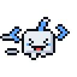

# Mascote `<R/>`

Mascote em pixel-art feito a partir da logo **&lt;rafinhadr/&gt;**: o corpo branco é o "R", os sinais `<` e `>` viraram as mãozinhas flutuando e a `/` virou a antena.

| parado | digitando | feliz | acenando |
|:-:|:-:|:-:|:-:|
|  |  |  |  |
| **pensando** | **dormindo** | **erro** | |
|  |  |  | |
| **andando** | **carregando** | **rindo** | **tramando** |
|  |  |  |  |
| **espiando** | **assustado** | **emburrado** | **convencido** |
|  |  |  |  |
| **bocejando** | | | |
|  | | | |

**programando**


## Arquivos

| Pasta | O que tem | Pra que serve |
|---|---|---|
| `gif/*.gif` | 256px (largura do `programando` é 384px), fundo transparente | Embeds do bot, emojis animados, site |
| `gif/*-128.gif` | 128px | Emoji do Discord (tamanho recomendado) |
| `svg/*.svg` | Animado em CSS, escala sem perder qualidade | README do GitHub, site |
| `png/*.png` | Primeiro quadro de cada animação em 512px, transparente | Figurinha, imagem estática |
| `png/avatar.png` / `avatar-feliz.png` | 512px com fundo escuro da logo | Foto de perfil do bot |

## Usando no bot (discord.js v14)

```js
const { AttachmentBuilder, EmbedBuilder } = require('discord.js');
const path = require('node:path');

function mascote(estado = 'parado') {
  const nome = `${estado}.gif`;
  return {
    arquivo: new AttachmentBuilder(path.join(__dirname, 'assets/mascote/gif', nome), { name: nome }),
    url: `attachment://${nome}`,
  };
}

// exemplo: embed de erro
const { arquivo, url } = mascote('erro');
const embed = new EmbedBuilder().setTitle('Deu ruim!').setThumbnail(url);
await interaction.reply({ embeds: [embed], files: [arquivo] });
```

Estados prontos: `parado`, `digitando`, `programando`, `feliz`, `acenando`, `pensando`, `dormindo`, `erro`, `andando`, `carregando`, `rindo`, `tramando`, `espiando`, `assustado`, `emburrado`, `convencido`, `bocejando` (as últimas foram feitas pro pet de tela).

## Mudando ou criando poses

Tudo sai do `gerar_mascote.py` (cores, poses e animações ficam no código). Depois de editar:

```bash
pip install pillow
python3 desenho/gerar_mascote.py
```
